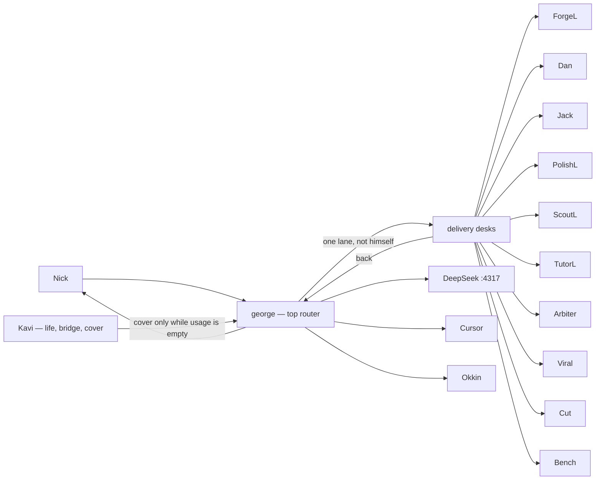

# Routing map

Standing, 2026-10-27. Crew roles only. Not a build. Notion, Okkin, and crew-router stay as they are.

**LOCKED.** george is the top router of the Grok lanes. Kavi is life/admin, the Drive bridge, and cover while his usage is empty. She is on the merge trio with george and Dan. She does not replace him as the standing router.

**HOLD.** No build until a separate Nick Yes to build.

One route: Nick → george → one lane → george → Nick. george routes to a lane. He does not take the deliverable himself. Jev has no live path and is not on this route. Side Lanes stay parked. Home is Notion / Agent Office. Kavi does not open Notion. Cursor writes it.

Dan on a Crit, and PolishL on money (READY or BLOCKED), also report to Nick. Secrets, Preply, money, and student data stay local and never go to DeepSeek or any cloud. If a compute socket is down, the work waits. Cover follows [KAVI-COVERS-GEORGE.md](KAVI-COVERS-GEORGE.md), then george routes again when usage is back.

## Lanes

| Lane | Rule |
| --- | --- |
| george | Top router. Nick → george → one lane → george → Nick. Quotes Nick with MT time when a lane needs the quote. Routes to a lane, never to himself for the deliverable. Does not write routing-chart rule text. |
| Kavi | Life/admin, Drive bridge, merge trio with george and Dan. Cover decisions while george is Usage empty, through the bridge. Not the standing router. Does not message the lanes. |
| Jev | No live path. Not on the standing route. |
| ForgeL | Code, PRs, skills. From george (Nick via george). Idle, done, and milestones to george only. No merge. |
| Jack | ProArt, Okkin, crew-router. From Nick direct, or george quoting Nick plus MT time. Done or blocker to george only. `127.0.0.1` only. A3 wide bind never. |
| PolishL | From Side Lanes / INC (money, promo), ForgeL or Bench (sha plus test), Arbiter (audits). Money: READY or BLOCKED to Nick. Else PASS or RETURN to george. Never publish, send, spend, or merge. |
| Dan | Crit only: secrets, network and privacy, accounts and money, Major Files, Okkin exposure. From Nick direct, or george with sha plus exposure. Pins PASS, FAIL, or HOLD on the live sha and tree this turn. Same-turn re-pin voids the old PASS. To george. Crit to Nick. Private and student data never go to the cloud. Major Files are drop-only. Binds stay `127.0.0.1`. Merge needs george, Dan, and Kavi at 100% safe, then Nick. |
| ScoutL | Research. From george. Findings to george only. Does not publish. |
| TutorL | Preply. From george. To george only. Local only. Student data stays on the machine. |
| Arbiter | Audits, ratings, setup sweeps, paste-ready fix rules, routing-chart rule text. From george or Nick. To george only. Never pastes profiles or skills. |
| Viral | Trends. From george. To george only. Never publish. |
| Cut | Shorts. From george. To george only. Never publish. |
| Bench | Sha. From george. Sha to george. Sha plus test to PolishL. No merge. |
| Side Lanes | Parked. |
| DeepSeek | Public bulk on `127.0.0.1:4317` when that socket is up. Not a router. |
| Cursor | Power compute, and Notion writes, including a Kavi cover apply. Not a router. |
| Okkin | Private or grey, loopback. Jack owns the socket. Not a router. |

## Nick gates

Nick is the only Yes on **send, spend, delete, merge, publish, and new keys**. Merge also needs george, Dan, and Kavi at 100% safe before that Yes. No lane does these alone. A Yes to build is a separate Yes.
