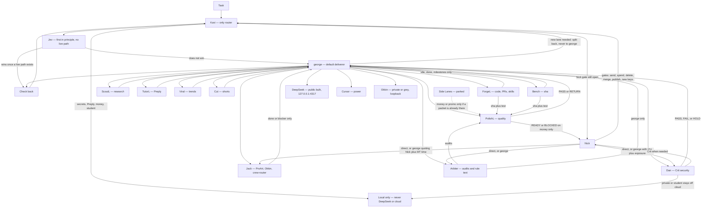

# Routing map

Draft for Nick, 2026-10-27. Crew roles only. This file does not build anything, does not edit Notion, and does not change Okkin or crew-router.

**HOLD.** No build, no bridge change, and no code feature from this map until Nick says Yes. Kavi's corrected plan is not built. PolishL is standing by to gate this file (PASS or RETURN to george). A Dan pin is not on it yet.

Sources merged here: Kavi's corrected route (task → Kavi only → Jev first → george delivers → DeepSeek / Cursor / Okkin → check back; george never routes to george) and the standing Grok lanes (ForgeL, Dan, Jack, PolishL, ScoutL, TutorL, Arbiter, Viral, Cut, Bench; Side Lanes parked). Lane one-liners from ForgeL, Jack, PolishL, Dan, and Arbiter on 2026-10-27 are folded in below. Home stays Notion / Agent Office. Secrets, Preply, money, and student data stay local only.

## Whole ecosystem

Jev has no live path. Until one exists, george is the default deliverer. Cursor is the power compute. DeepSeek runs public bulk only on `127.0.0.1:4317` when that socket is up. Okkin is private or grey work on loopback. If a compute socket is down, the work waits. When george's usage is empty, cover still follows [KAVI-COVERS-GEORGE.md](KAVI-COVERS-GEORGE.md): Kavi decides through the bridge, Cursor applies, and Kavi does not message the lanes.

## Lanes

| Lane | Routes | Delivers | Reports to | Gates |
| --- | --- | --- | --- | --- |
| Kavi | Every task. The only router. | Life/admin and bridge issues. Cover decisions while george is Usage empty. | Check-back lands here, then Nick only when a gate is open. | Does not send, spend, delete, merge, or publish. |
| george | No one. A packet that needs a new lane splits back to Kavi. He never routes to himself. | Default deliverer until Jev has a live path. Carries the lane Kavi already chose. Quotes Nick with MT time when a lane requires the quote. | Kavi, after the lane reports. | Does not write routing-chart rule text. Hands that to Arbiter. |
| Jev | None until a live path exists. | Would deliver when he wins a task. | Kavi. | No live path yet. Not built. |
| ForgeL | From george, Nick via george, on a Kavi route. | Builds, PRs, skills. | george only: idle, done, milestones. | Does not merge. |
| Jack | Nick direct, or george quoting Nick plus MT time. | ProArt, Okkin, crew-router. | george only: done or blocker. | `127.0.0.1` only. A3 wide bind never (`0.0.0.0:4600`, `[::]:4600`). |
| PolishL | Side Lanes / INC for money or promo. ForgeL or Bench for sha plus test. Arbiter for audits. | Quality read. Gates this file. | Nick only as READY or BLOCKED on money. Otherwise george, PASS or RETURN. | Never publish, send, spend, or merge. |
| Dan | Nick direct, or george with a job or ticket that names sha and exposure. | Crit security only: secrets, network and privacy, accounts and money, Major Files, Okkin exposure. Pins PASS, FAIL, or HOLD on the live sha and tree this turn. | george. Crit to Nick when needed. | Same-turn re-pin voids the old PASS. Private and student data never go to DeepSeek or any cloud. Major Files are drop-only. Binds stay `127.0.0.1`. A merge needs george, Dan, and Kavi at 100% safe, then Nick's OK. |
| ScoutL | From george on a Kavi route. | Research. | george. | Does not publish. |
| TutorL | From george on a Kavi route. | Preply. | george. | Preply stays local only. |
| Arbiter | From george or Nick, on a Kavi route. | Audits, ratings, setup sweeps, paste-ready fix rules. Rule text for routing charts. | george only. | Never pastes profiles or skills. |
| Viral | From george on a Kavi route. | Trends. | george. | Does not publish. |
| Cut | From george on a Kavi route. | Shorts. | george. | Does not publish. |
| Bench | From george on a Kavi route. | Sha. | george. Sha plus test also goes to PolishL. | Does not merge. |
| Side Lanes | Parked. | None while parked. | — | Stay parked. |
| DeepSeek | Not a router. | Public bulk on `127.0.0.1:4317`. | The deliverer. | No secrets, Preply, money, or student data. |
| Cursor | Not a router. | Power compute. Notion writes, including a Kavi cover apply. | The deliverer. | Does not pick the lane. |
| Okkin | Not a router. | Private or grey work, loopback. | The deliverer. | Jack owns the socket. No wide bind. |

## Nick gates

Nick is the only Yes on each of these. A lane must not do them on its own.

- **Send** — outbound messages and shares.
- **Spend** — money or a new paid account.
- **Delete** — destroy a row, file, or key material.
- **Merge** — after george, Dan, and Kavi are 100% safe. Bots do not merge.
- **Publish** — public posts, including Viral and Cut.
- **New keys** — Dan's list. Nick's OK before any new key.

**HOLD builds** until Nick says Yes to this map. Saying Yes to the map is separate from saying Yes to a build. Kavi's plan stays unbuilt either way until that second Yes.

## Fixes this map locks

- george never self-routes. A packet aimed at george splits back to Kavi.
- Jev is first in principle and has no live path. george delivers until that path exists and wins.
- Routing-chart rule text is Arbiter's. george does not self-write it.
- Private and student data never go to DeepSeek or any cloud. Major Files are drop-only.
- Jack's binds stay on `127.0.0.1`. A3 stays a stop.
- Dan's PASS is only for the live sha and tree he pinned this turn. A new pin the same turn voids the old PASS.

## Nick Yes/No

**Yes/No:** While Kavi and george are both live, Kavi is the only router and george only delivers and returns — he never picks a lane, including himself. Yes locks that. No restores george as top router of the Grok lanes (Nick → george → lane → george → Nick) and leaves Kavi on life/admin, the bridge, and cover while his usage is empty.

This draft recommends Yes. The Grok lanes above stay delivery desks either way. Their report lines do not change. What changes is who is allowed to choose the next lane.
