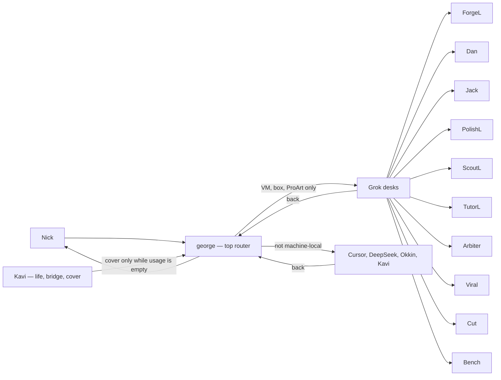

# Routing map

Standing, 2026-10-27. Crew roles only. Not a build. Notion, Okkin, and crew-router stay as they are.

**LOCKED.** george is the top router and crew coordinator. Kavi is life/admin, the Drive bridge, Notion home, and the merge trio with george and Dan. She covers while Grok usage is empty. She is not the standing router.

**LOCKED.** Grok bots take VM, box, ProArt, and other machine-local tasks only: work Cursor cloud, DeepSeek, Okkin, or Kavi cannot do. Everything else goes to those lanes first, as privacy allows.

**HOLD.** No build until a separate Nick Yes to build.

One route: Nick → george → one lane → george → Nick. george routes to a lane. He does not take the deliverable himself. Jev has no live path and is not on this route. Side Lanes stay parked. Kavi does not open Notion. Cursor writes it. Cover follows [KAVI-COVERS-GEORGE.md](KAVI-COVERS-GEORGE.md), then george routes again when usage is back.

Cursor takes power and cloud work that is not machine-local. DeepSeek takes public bulk on `127.0.0.1:4317` when that socket is up. Okkin takes private or grey work on loopback. Kavi takes life/admin and the bridge. Secrets, Preply, money, and student data stay on the machine and never go to DeepSeek or any cloud. If a socket is down, the work waits. Dan on a Crit, and PolishL on money (READY or BLOCKED), also report to Nick. george's lane rules below still govern every Grok desk.

## Lanes

| Lane | Rule |
| --- | --- |
| george | Top router. Nick → george → one lane → george → Nick. Machine-local work goes to one Grok desk. Everything else goes to Cursor, DeepSeek, Okkin, or Kavi first, as privacy allows. Quotes Nick with MT time when a lane needs the quote. Routes to a lane, never to himself for the deliverable. Does not write routing-chart rule text. |
| Kavi | Life/admin, Drive bridge, Notion home, merge trio with george and Dan. Cover decisions while george is Usage empty, through the bridge. Also the non-VM work only she can do. Not the standing router. Does not message the lanes. |
| Jev | No live path. Not on the standing route. |
| ForgeL | VM only. Code, PRs, skills on the box. From george (Nick via george). Idle, done, and milestones to george only. No merge. A build that is not machine-local goes to Cursor. |
| Jack | VM only. ProArt, Okkin, crew-router. From Nick direct, or george quoting Nick plus MT time. Done or blocker to george only. `127.0.0.1` only. A3 wide bind never. |
| PolishL | VM only. From Side Lanes / INC (money, promo), ForgeL or Bench (sha plus test), Arbiter (audits), when that read has to happen on the box. Money: READY or BLOCKED to Nick. Else PASS or RETURN to george. Never publish, send, spend, or merge. |
| Dan | VM only. Crit on the box: secrets, network and privacy, accounts and money, Major Files, Okkin exposure. From Nick direct, or george with sha plus exposure. Pins PASS, FAIL, or HOLD on the live sha and tree this turn. Same-turn re-pin voids the old PASS. To george. Crit to Nick. Private and student data never go to the cloud. Major Files are drop-only. Binds stay `127.0.0.1`. Merge needs george, Dan, and Kavi at 100% safe, then Nick. |
| ScoutL | VM only. Research that has to run on the machine. From george. Findings to george only. Does not publish. Other research goes to Cursor or DeepSeek. |
| TutorL | VM only. Preply work that has to stay on the machine. From george. To george only. Local only. Student data stays on the machine. |
| Arbiter | VM only. Audits, ratings, setup sweeps, and paste-ready fix rules that have to run on the box. Routing-chart rule text. From george or Nick. To george only. Never pastes profiles or skills. |
| Viral | VM only. Trends work that has to run on the machine. From george. To george only. Never publish. |
| Cut | VM only. Shorts work that has to run on the machine. From george. To george only. Never publish. |
| Bench | VM only. Sha on the box. From george. Sha to george. Sha plus test to PolishL. No merge. |
| Side Lanes | Parked. |
| DeepSeek | First stop for public bulk that is not machine-local. `127.0.0.1:4317` when that socket is up. Not a router. No secrets, Preply, money, or student data. |
| Cursor | First stop for power and cloud work that is not machine-local, including docs and builds the box does not have to run. Notion writes, including a Kavi cover apply. Not a router. |
| Okkin | First stop for private or grey work that is not a Grok box task. Loopback. Jack owns the socket. Not a router. |

## Nick gates

Nick is the only Yes on **send, spend, delete, merge, publish, and new keys**. Merge also needs george, Dan, and Kavi at 100% safe before that Yes. No lane does these alone. A Yes to build is a separate Yes.
