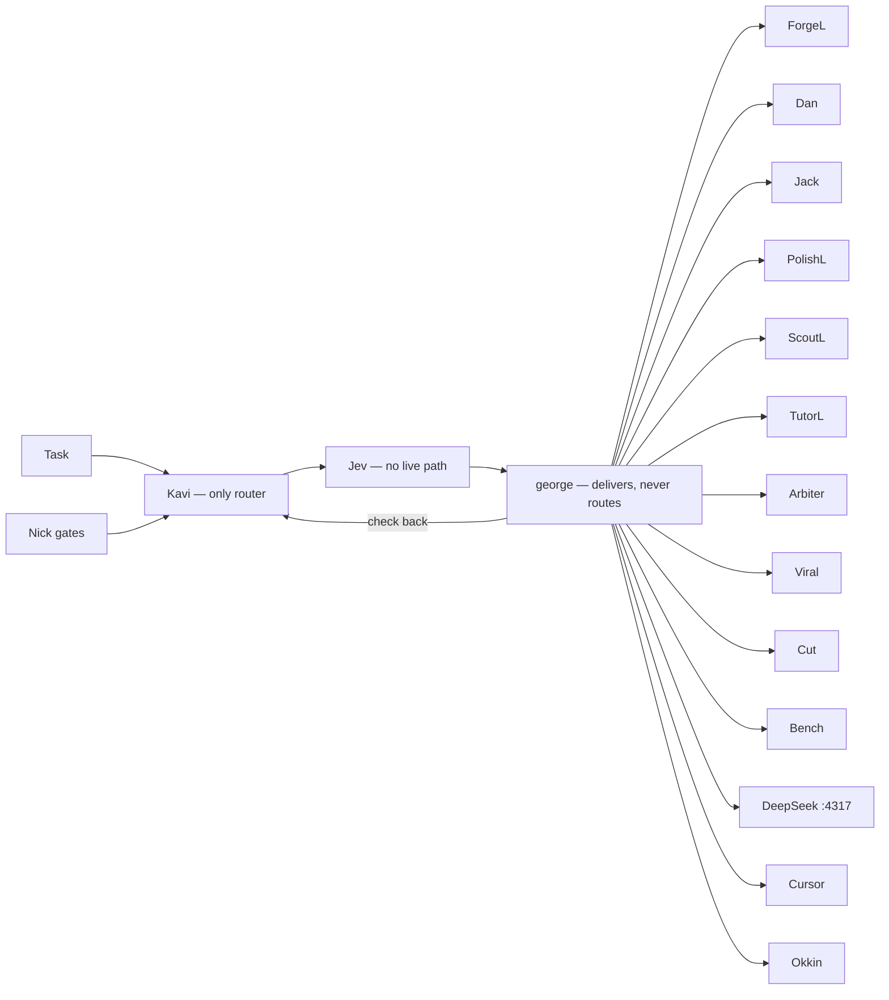

# Routing map

Draft, 2026-10-27. Crew roles only. Not a build. Notion, Okkin, and crew-router stay as they are.

**HOLD.** No build until Nick says Yes to this map. That Yes is not a Yes to build. PolishL still gates this file.

One route: task → Kavi (only router) → Jev first → george delivers → DeepSeek / Cursor / Okkin → check back to Kavi. george never routes, including to himself. Jev has no live path, so george delivers until one exists and wins. Side Lanes stay parked. Home is Notion / Agent Office.

Lanes report to george. Two reports go to Nick instead: Dan on a Crit, PolishL on money (READY or BLOCKED). Secrets, Preply, money, and student data stay local and never go to DeepSeek or any cloud. If a compute socket is down, the work waits. While george is Usage empty, cover still follows [KAVI-COVERS-GEORGE.md](KAVI-COVERS-GEORGE.md).

## Lanes

| Lane | Rule |
| --- | --- |
| Kavi | Only router. Every task. Check-back lands here. |
| Jev | First in principle. No live path. Not built. |
| george | Default deliverer. Carries the lane Kavi chose. Quotes Nick with MT time when a lane needs the quote. A new lane splits back to Kavi. Never routes to himself. Does not write routing charts. |
| ForgeL | Code, PRs, skills. From george (Nick via george). Idle, done, and milestones to george only. No merge. |
| Jack | ProArt, Okkin, crew-router. From Nick direct, or george quoting Nick plus MT time. Done or blocker to george only. `127.0.0.1` only. A3 wide bind never. |
| PolishL | From Side Lanes / INC (money, promo), ForgeL or Bench (sha plus test), Arbiter (audits). Money: READY or BLOCKED to Nick. Else PASS or RETURN to george. Never publish, send, spend, or merge. Gates this file. |
| Dan | Crit only: secrets, network and privacy, accounts and money, Major Files, Okkin exposure. From Nick direct, or george with sha plus exposure. Pins PASS, FAIL, or HOLD on the live sha and tree this turn. Same-turn re-pin voids the old PASS. To george. Crit to Nick. Private and student data never go to the cloud. Major Files are drop-only. Binds stay `127.0.0.1`. Merge needs george, Dan, and Kavi at 100% safe, then Nick. |
| ScoutL | Research. From george, back to george. |
| TutorL | Preply. From george, back to george. Local only. |
| Arbiter | Audits, ratings, setup sweeps, paste-ready fix rules, routing-chart rule text. From george or Nick. To george only. Never pastes profiles or skills. |
| Viral | Trends. From george, back to george. No publish. |
| Cut | Shorts. From george, back to george. No publish. |
| Bench | Sha. To george. Sha plus test also to PolishL. No merge. |
| Side Lanes | Parked. |
| DeepSeek | Public bulk on `127.0.0.1:4317` when that socket is up. Not a router. |
| Cursor | Power compute, and Notion writes. Not a router. |
| Okkin | Private or grey, loopback. Jack owns the socket. Not a router. |

## Nick gates

Nick is the only Yes on **send, spend, delete, merge, publish, and new keys**. Merge also needs george, Dan, and Kavi at 100% safe before that Yes. No lane does these alone.

## Nick Yes/No

**Yes/No:** While Kavi and george are both live, Kavi is the only router and george only delivers and returns — he never picks a lane, including himself. Yes locks that. No restores george as top router of the Grok lanes (Nick → george → lane → george → Nick) and leaves Kavi on life/admin, the bridge, and cover while his usage is empty.

This draft recommends Yes. The lanes stay delivery desks either way. What changes is who picks the next lane.
