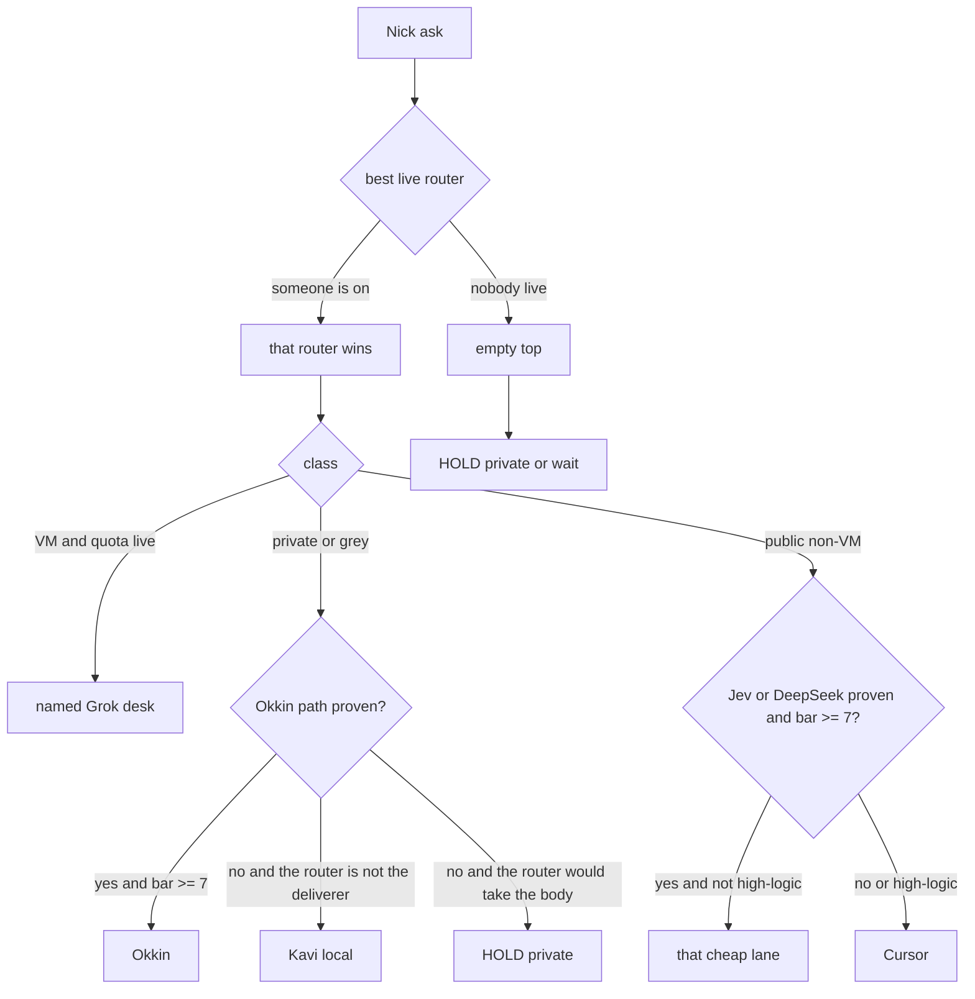

# Ultimate routing system

Merit pick is in this repo (`src/server/router/merit.ts`). `ROUTER_ON` defaults off, so the office does not use it until that flag is the exact string `1`. The picker does not call a provider, change bind, or spend.

Nick Yes on 2026-10-27 for the merit system is a build Yes for this picker. It is not a merge Yes. HOLD merge until Nick says Yes on the merge itself. A relayed quote is not that Yes.

[STABLE-6-12MO-PLAN.md](STABLE-6-12MO-PLAN.md) and [KAVI-COVERS-GEORGE.md](KAVI-COVERS-GEORGE.md) stay the operating pages for lanes this picker does not turn on. The office build does not read this file or [routing-flow.json](routing-flow.json).

`docs/ROUTING-MAP.md` is not in this repo. It was not added. The short map is the diagram below. The machine graph for a 3D view is [routing-flow.json](routing-flow.json). One graph, so the two cannot drift.

Privacy: grey. Ops only. No secrets, tokens, student data, or machine addresses.

| | |
|---|---|
| Author lane | Cursor (`lane=cursor`, `why-cheapest=routing-system doc synthesis needs strong write`). The router does not own this body. |
| Gate | PolishL, then Nick Yes/No on the plan. Dan if a later change touches bind, auth, the router, or Okkin. |
| Decision | Nick Yes on the merit build is recorded. Merge still needs his own Yes. |
| Repo | This file is in `nicholibb-prog/agent-office`. `llm-stack` = GitHub `nicholibb-prog/optimized-llm-stack`. `shamar-spine` = Origin `nicholi-butterfield/shamar-spine`. Those two were not audited for this page. |

Packets this page is built from (bytes hashed this turn; Nick threads were not re-opened):

| Packet | sha256 of the bytes used |
|---|---|
| Research brief (packet says PolishL PASS) | `242dca9ee58bcb608f73300b4a8050a9a882787836890abf5b8d6267ca4fbc77` |
| Arbiter failure catalog | `fac641fe845413277f9f2b24b6817ed6b65e8e79995ef01725d76d6cdb5f0544` |
| Kavi merge notes | `e14a0330f11fba6a6152be5c51f65e520a2e3671f6fe44bbc1d462174ca48235` |
| Kavi A/B/C dive | `d604361deacb9a850c29031fd102ef3717c9b9f7a39b1f8557897d8c1b5e67be` |
| Crew-router H2H report | `4a0522c5568595202632e185b262bf4687fd59661b5517067de76085abc51c36` |

Paper cost and quality figures below are the papers' claims. They are not Nick's measured spend.

## 1. One-screen default path

A new Nick ask gets an owner the same turn. The ask is not bounced back as "who should own this?"

Jev is evaluated first on a public ask and cannot win. There is no live path in these packets, so the arrow to Jev is not taken.

Then, for anything with a body: PolishL gates the text. Dan gates security (bridge, auth, router, Okkin, secrets, bind). Kavi oversees unless she wrote the body, in which case Arbiter records it. Nick is asked only for Yes/No on merge, delete, publish, create-bot, spend, or bind/config.

Rules that sit on that picture:

- The top router is not a fixed person. Each task, the best live router wins (see [MERIT](#merit)). When george is out or not live, the top slot is empty or the next live router wins. Kavi can be that router. She is always overseer. Overseer means verify, check, record, escalate. Overseer is not the deliverer on that job. A router never routes a deliverable body to itself.
- Grok desks are VM / box / ProArt only, and only by name: ForgeL, Dan, Jack, PolishL, ScoutL, TutorL, Arbiter, Viral, Cut, Bench. Quota was not probed for this page. If it is not verified this turn, those desks are not used.
- Non-VM public work is considered in this order: Jev (cannot win yet), then DeepSeek (unproven), then Cursor. Private or grey is Okkin (unproven) then Kavi. Unproven lanes are skipped. Cursor is the public non-VM lane that [STABLE-6-12MO-PLAN.md](STABLE-6-12MO-PLAN.md) already allows.
- Private or grey goes to Okkin only after a proven live path and a score of at least 7/10. Until then it stays with Kavi local when george routed it. When Kavi herself is the router, private work HOLDs. It does not go to Cursor, DeepSeek, or Grok.
- Cheap is allowed only at or above 7/10. Under 7, escalate. Cheapest-only is forbidden. A brief shows `lane=` and `why-cheapest=`.
- The router sends Nick at most two sentences: owner and link. Tables, charts, plans, and rewrites are the owner's body.
- Six fixed subagents when Kavi is router: R1, R2, R3, T1, T2, G1. No seventh.

## MERIT

Score, then lane. Presence is a gate. It is not a point.

1. A candidate with presence `on` is eligible. `out` and `absent` score 0 and cannot win. No heartbeat, or a heartbeat older than the working lease, is not `on`.
2. The score is lane fitness, from 0 to 10. Defaults: research 8/6, Grok/ProArt 8/5, high-logic 8/5, privacy 8/4, public bulk 7/6, general 6/6 (george, then Kavi). A task may pass a different fitness. The higher score wins, including when that person is Kavi and george is also live.
3. An equal score breaks toward the router who is not the overseer (`tieBreak: role-split`). That keeps oversight a separate job. It is not a lock: a higher fitness still beats it, and an absent router still scores 0.
4. The lane is chosen after the winner. Public research uses Jev only when that path is already proven at 7/10, else DeepSeek only when proven, else Cursor. High-logic goes to Cursor even if a cheap lane is proven. Grey VM work goes to ForgeL only when quota is live this turn, else it waits. Private, grey, and secret never use DeepSeek, Jev, or the other public-cloud lanes. Okkin only when that path is proven. Otherwise george hands the body to Kavi local, and Kavi as router HOLDs, because she cannot take the body.
5. Nobody eligible: `top` is null. Public waits. Private and grey use `hold-private`. No lane is invented.
6. The office reads this only when `ROUTER_ON=1`. `GET /api/router/merit` is the active top. `POST /api/router/merit` is the assign path (`id`, `privacy`, `kind`, optional `link`). Both are owner-only. The body cannot turn a proof on. `GET /api/bridge/crew-status` adds `merit` only while the flag is on. Nick's note is at most two sentences, owner then link, and the merit log does not store the link.

## 2. Who / why

Ids match [routing-flow.json](routing-flow.json).

| Task | Owner | Why | Failover | Privacy |
|---|---|---|---|---|
| New ask, george is the best live score | `george-router` | Merit, not a locked seat. Two sentences to Nick. No body. | `kavi-router-2` | grey |
| New ask, george out and Kavi is live | `kavi-router-2` | Next-best live router. She still does not deliver. | `empty-top` | grey |
| New ask, no live router | `empty-top` | Top slot stays empty. Private and grey HOLD. Public waits. | `hold-private` | grey |
| Check the route and the result | `kavi-overseer` | Always on. Verify, check, record, escalate. She does not assign and does not rewrite. | `arbiter` when she wrote the body | grey |
| Life, admin, money, memory, bridge | `kavi-local` | Deliverer slot, used when someone else routed the job. | `hold-private` if she is the router | private |
| Notion Front Desk write | `cursor` | Cursor writes Notion. Kavi has no Notion login. george names the row while State is ON. Cover files follow [KAVI-COVERS-GEORGE.md](KAVI-COVERS-GEORGE.md). | `wait` | grey |
| Public one-shot research Nick is waiting on | `cursor` | DeepSeek has no live result in these packets. | `wait` if Cursor usage is exhausted. `scoutl` is a separate assignment when Grok quota is live and the source bar is met, not a fall-through from Cursor | public |
| Standing research watch | `researcher-pool` | Cheap-first claim queue, digest, partial-at-cap. The pool is a design. It is not built. | `digest` | public |
| Public bulk after DeepSeek is proven and the bar is met | `deepseek` | Target cheap lane. Cascade then stop (FrugalGPT pattern). Not the lane today. | `cursor` | public |
| Private or grey, Okkin path proven, bar met, Nick already Yes on bind | `okkin` | Locality. Cloud and DeepSeek do not take this class. | `kavi-local` if george routed; `hold-private` if Kavi routed | private |
| Private or grey while Okkin is unproven | `kavi-local` or `hold-private` | H2H: loopback mismatch. Lane stays unproven until Nick Yes on bind/config. | `hold-private` | private |
| Non-VM code, grey docs with no secrets | `cursor` | Governing non-VM lane in the stable plan while DeepSeek is unproven. Usage exhausted stops the lane. | `wait` | grey |
| VM / box / ProArt code | `forgel` | Named desk. Only with Grok quota verified this turn. | `cursor` if the job is not tied to the machine; else `wait` | grey |
| Office, Okkin socket, crew-router socket | `jack` | Local check. No model. Does not edit bind or config. | `stop` | grey |
| Security review | `dan` | Gate on bridge, auth, router, Okkin, secrets, bind. Stable plan runs this on the Cursor pool. | `wait` | grey |
| Text before Nick | `polishl` | Gate before Nick. Owners write. A missing desk means wait, not skip. | `wait` | grey |
| Routing failure, kill-line audit | `arbiter` | Meta-work is work. The router does not fix his own miss. | `stop` | grey |
| Crew research while Kavi is router | `r1` `r2` `r3` | Fixed trio. One claim each. No second researcher on the same claim. | `digest` | public |
| Tests while Kavi is router | `t1` `t2` | Fixed pair. One claim each. | `stop` | grey |
| Other overflow while Kavi is router | `g1` | The only general overflow. | `stop` | grey |
| Jev candidate | `jev` | Evaluated first. Wins only with a live path, a score ≥ 7/10, and a lower cost than the next passing lane. None of that is shown here. | `cursor` on public; never on private or grey | public |
| Merge, delete, publish, create-bot, spend, bind/config | `nick-yes` | His own words. george + Dan + Kavi at 100% safe does not replace him where he is required. | `stop` | grey |
| Student content | none | TutorL is a named desk and is not assigned. No student title, row, or git body. | `stop` | private |
| Viral, Cut | none | Named VM desks. These packets do not define a specialty. Do not invent one. | `stop` | grey |
| Bench | none | Named seat. Front Desk cleanup: no ops job. Do not restore that Notion row here. | `stop` | grey |
| Log, kill, prune proposal | `hive` | Learns from route, cost, quality, miss. Does not choose the next owner. Not built. | `george-router` reads a kill; `nick-yes` before any delete | grey |

Quality bar: a cheap result under 7/10 goes to `bar-7`, then escalates (public → `cursor`; private → `kavi-local` or `hold-private`). The router does not grade his own page.

## 3. Bias, side by side

Kavi's A/B map is her read (drive packet 2026-10-27 13:32 MDT). Standing lines and the Arbiter catalog govern where they disagree. Nothing in her packet is locked.

| Topic | Kavi A/B | Standing / Arbiter | Disposition |
|---|---|---|---|
| Who routes | She oversees; george routes; she routes only if he is out. She concurs the 13:22 "Kavi only router" lock is dead. | Arbiter hard-no on a Kavi-only lock. | **Supersede the locked top.** The best live router wins. Overseer ≠ router ≠ deliverer stays. Kavi is not the only router by default. |
| george delivers | Her ideal line says if Jev loses, george delivers. | Deliverable text is never the router's. Grok desks are named bots. "george" is not a deliverer lane. | **Keep** standing. `george-deliverer` is `live: false`. Her "george delivers" line is not adopted. |
| Cheapest vs floor | She flags the tension and keeps 7/10. | No strongest/available default. No cheapest-only. | **Keep.** Cheap-first is a cascade with a stop score, after the floor. |
| Jev first | Evaluated first. Wins only when cheaper and better, with a live path. Later Yes, not now: default-first after a real job proves both. | Same. v3 is not a live win. No score is invented here. | **Keep.** **Change later** only after a live job and Nick's own Yes. |
| Okkin for private now | Remote path not live. Ollama localhost-bound. Binding change needs Nick's tap. | Private/grey → Okkin once proven; until then Kavi local. H2H confirms the crew-router loopback does not connect. | **Keep.** Lane `unproven` until Nick Yes on bind/config. |
| Grok for every VM job | Quota fragile (out Oct 21–24, about 79h, her read). A lane that vanishes is not a default. | Named desks, VM only, and only when quota is live this turn. Cover rule while Usage empty: [KAVI-COVERS-GEORGE.md](KAVI-COVERS-GEORGE.md). | **Keep.** Quota was not re-measured for this page. |
| DeepSeek-first | She has never seen a live DeepSeek result. Direct path parked Oct 25. Tier-1 not run (Jack HOLD, ISS-036). | Arbiter: public bulk → DeepSeek. Stable plan: DeepSeek is not the default; Cursor is, and only when the crew-router socket is up and Cursor usage is gone. | **Keep** Cursor as the public lane now. **Change later:** DeepSeek-first for public bulk after a live path, a ≥ 7/10 score, and Nick Yes. This page does not flip the stable plan. |
| Build the hive | She says HOLD. | No system build from the map. No deletes. | **Hold.** |
| Cover file may set lane george | Not her proposal. The cover parser still allows lane george ([KAVI-COVERS-GEORGE.md](KAVI-COVERS-GEORGE.md)). | Ultimate rule: george is not a deliverer. | **Keep** the rule in this plan. **Change later:** parser, only with Nick Yes. This PR does not edit the parser. Until then, do not use lane george as the author of a body. |
| PolishL, ScoutL, Arbiter, Bench on Notion | She still uses PolishL, ScoutL, and Arbiter as roles. | Front Desk cleanup trashed those rows as program-only lanes with no ops job ([FRONT-DESK-CLEANUP.md](FRONT-DESK-CLEANUP.md)). | **Keep** the roles in this plan. **Hold** any Notion restore. Work reaches a live VM desk by a router brief, not by recreating a trashed row. Notion is not the router UI. |
| ScoutL volume | She over-weights volume against the source bar. | Good-source bar stands. | **Keep** the bar. |
| PolishL speed | Gate before Nick, not instead of delivery. | Same. A down desk means wait. | **Keep.** |
| Dan | No miss she will invent. | Security gate. | **Keep.** No invented miss. |
| Jack | ISS-036 and a curl failure still unverified on her re-check. | One status line, one sha. H2H is a separate fact (section 9) and is not a Jack PASS. | **Keep.** Do not merge those into one PASS. |
| Arbiter timing | Hard-no is right and arrives after the draft. | Check standing lines before the draft. | **Keep** the check. The merit picker is the later build, and it stays off until `ROUTER_ON=1`. |
| Cursor cost | She cites creep from $20 to $60/mo as her read. | Cursor is the failover and the current public lane, not "always strongest." | **Keep.** The dollar figures are her read, not a bill re-checked here. |
| Viral, Cut, Bench jobs | Her one-page map does not define them. | They are on the named VM list. Bench has no ops job on the cleaned desk. | **Keep** them unnamed. **Change later** only if Nick defines a job. |
| Six subagents | R1–R3 research, T1–T2 test, G1 overflow. Count stays 6. | Same hard no. | **Keep.** |

Her past miss (Oct 25, Notion "done" when only the sync engine was read back) and george's past miss (the 13:22 lock) are recorded so the hive can log them. They are not re-litigated here.

## 4. Constant researchers

Design only. Section 8 holds the build. Patterns are from the research brief (ScoutL, sha above), sections (c) and (d).

The pool is for standing watches. A one-shot Nick is waiting on is section 2, not this pool. The pool does not burn Grok, and it does not wake Cursor just because the cheap lane is unproven.

1. **Claim queue (C1).** Researchers sit idle until a claim exists. One owner per claim. No second desk on the same question. No self-spawned "meanwhile" survey.
2. **Retrieve, then generate (C2).** Search and fetch first. A model synthesizes hits. The cheapest live lane that can clear 7/10 does that synthesis. Today DeepSeek and Okkin are unproven, so a standing watch does not call them and does not call Cursor. It returns a partial digest: lane unproven.
3. **Digests, not streams (C3).** One markdown digest per window. The router sees deltas. Implementation detail of the clock is a guess in the brief; the pattern is the batch.
4. **Cache before wake (C4, A5).** Embedding cache of prior briefs (GPTCache pattern). A hit does not wake a researcher.
5. **Manager vs workers (C5, A8).** The active router assigns. Workers fetch and summarize. One polish gate. The router is not a worker.
6. **Difficulty (C6, A2, A3).** A trivial lookup stays on the tiny live lane. Compare and conflict go up. Do not pay a power model to fetch a page. RouteLLM's published claim is ≥85% cost cut on MT Bench at about 95% of GPT-4 quality. That is their report, not this crew's bill.
7. **Stable prefix (C7, A6, A7).** Freeze the research rules and cite rules at the top. The question is last. No timestamp in the prefix. Provider version strings in the brief are UNVERIFIED for Nick's stack.
8. **Partial at cap (C8, A12).** The brief states wall minutes and dollars. At the cap the owner returns `[partial N/M]` and stops. Three identical tool-plus-input repeats stop the same way (B7). No sibling thread to dodge the cap (B5).

While Kavi is Router #2, distinct claims go to R1, R2, or R3. T1 and T2 are tests, not this pool. G1 is overflow, not a researcher. ScoutL is a named Grok desk for one cited job when quota is live, not the idle pool.

## 5. Hive flywheel

The hive gets better by memory and gates. It does not route. `hive` is `live: false` until a build Yes.

Log, on each closed job: time, ask id, router id (`george-router` or `kavi-router-2`), lane id, `lane=`, `why-cheapest=`, privacy class, the live flag that was true at assign time, cost, PolishL score or `n/a`, one sha, miss, kill reason.

Kill, then the active router reassigns. The hive only notifies:

- quality under 7
- cost over the brief cap
- privacy breach (secret, token, student data, machine address, Major Files)

Weekly prune lists lanes with no live path, repeated kills, or a forbidden role. Removing a standing lane is a delete. It waits on `nick-yes`. This plan prunes nothing.

How it learns, without a self-route:

| Pattern | What this crew does with it |
|---|---|
| D1 Reflexion | After PolishL FAIL, the author stores a short reflection and loads it on the next similar job. |
| D4 ExpeL | After repeated similar jobs, the router commissions 3–5 public insight lines. Researchers cite them or say why not. Writing that brief is a routed deliverable. |
| D5 TextGrad | A failed pipeline criticizes the brief template and the router prompt. Patching that text is an owner's job, routed, not a router self-fix. |
| D2 Self-Refine | A cheap desk may critique its own draft once, then stop. That is not a license to skip PolishL or to hop models. |
| D6, B2, B3 | PolishL checks sha, cites, privacy, and the brief's checklist. FAIL reasons are mandatory input to the rewrite. "Looks done" is not a PASS. |
| D8, D11 | Nick Yes/No and PolishL PASS/FAIL are preference pairs for a later threshold. No training and no spend now. |
| D9, B8, A9 | Only the active router reassigns, and only after a verified blocker. Desks report up. They do not wake a peer for the same body. |
| B4, D10 | Merge, delete, publish, create-bot, spend, and bind pause for Nick's own Yes. |
| B6 | Error spike or burn spike opens the circuit. Fan-out stops. A half-open paid probe waits on Nick Yes. |
| A1 | The accept/escalate threshold is the thing the log is for. It is not a forever if/else, and it is not edited by the router in place. |

Kavi oversees the log. When she was the deliverer, Arbiter records that job so she does not check herself.

## 6. Live-path gate

`live` in the JSON:

| Value | Meaning |
|---|---|
| `true` | This plan allows the seat when the edge's `when` is true. It is not a heartbeat from this turn. |
| `false` | Forbidden, or a design that is not built. |
| `unproven` | Do not send real work. |

No invented `live: true` for Okkin, DeepSeek, or Jev.

| Lane | State | Evidence |
|---|---|---|
| Okkin / crew-router | **unproven** | Section 9. Loopback `http://127.0.0.1:11434` refused. `OLLAMA_HOST` was a Tailscale address that answered HTTP 200. The numeric host is left in the H2H packet and is not copied here (machine address). Bind/config not changed. Lane unproven until Nick Yes on bind/config (Dan + Nick). |
| DeepSeek | **unproven** | H2H set `ROUTER_CLOUD=0`. No cloud call. No score. Kavi: no live result on her side; Tier-1 not run; Jack HOLD; ISS-036 blocked. Stable plan: not the default. |
| Jev | **unproven** | No live job in these packets. Evaluated first. Cannot win. The office "Jev board" in [features.md](features.md) is a room scoreboard. It is not this lane. |
| Grok quota | **unproven this turn** | Not measured by the H2H. Named VM desks stay unused until a check this turn says quota is live. Two-line status from the router is the only Grok prose. |
| Cursor | allowed by the stable plan | Current public non-VM lane. If usage would bill on-demand, the lane writes `usage-exhausted` and stops. It does not switch on Grok Bot. |
| crew-router deliver path | **unproven** | Pin matched and the process started. Every run stopped `okkin-down`. That is not a quality result. Socket `127.0.0.1:4317` was left alone. |

Agent-office Okkin stays loopback-only by [hq.md](hq.md). That code fact is not a passing live job. The H2H failure is crew-router's `ollamaUrl` versus where Ollama was actually listening.

## 7. Kill-lines (MUST)

Arbiter's eight, verbatim, then the row lines and the merge hard-nos. A router that cannot obey one stops and hands the job to Arbiter.

1. **MUST NOT** self-route a deliverable, including a "status" chart. **MUST** route a rewrite, plan, chart, or standing-order the same turn. Nick gets at most two sentences: owner and link.
2. **MUST NOT** self-fix a routing failure. Diagnosis goes to Arbiter.
3. **MUST** pick the cheapest lane that passes 7/10 among lanes with a live path. **MUST NOT** default to strongest or merely available. A brief shows `lane=` and `why-cheapest=`. An unsure probe uses a lane already proven. It does not probe DeepSeek, Okkin, or Jev while they are unproven, and it is not a Grok essay.
4. **MUST NOT** lock the top seat to one person, and **MUST NOT** make the overseer the only router by default. The best live router wins. Kavi routes when she wins that score, including when george is out. She is always overseer, and she does not take the body.
5. **MUST NOT** put bulk on Grok. Public bulk targets DeepSeek only after the live-path gate. Private/grey targets Okkin only after that gate. Until then, section 2's failover. Grok is computer-specific named desks, gates, or a two-line status.
6. **MUST** default a lane the same turn. **MUST NOT** ask Nick who should own it. Ask him only for Yes/No on spend, delete, merge, create-bot, publish, or bind/config.
7. **MUST NOT** say PASS without that sha's gate, re-read, with owner and MT time. One status line, one sha. **MUST NOT** merge two shas into "all pass."
8. **MUST NOT** merge, delete, publish, create a bot, or spend without Nick's own Yes. A george+Dan+Kavi safety note does not replace him where he is required.
9. **Pre-send.** A table, or three or more paragraphs, or a chart, map, plan, or routing system is the owner's body. There is no "status / how I work" exception. This file is that body, on the Cursor lane, for PolishL.
10. **Answer-with-route.** If the line needs a deliverable, the first action is the route, not a Grok explanation.
11. **MUST NOT** route with no verified live path. **MUST NOT** invent results, scores, or PASS lines.
12. **MUST NOT** build this system from the map. **MUST NOT** delete. **MUST NOT** add or remove a subagent. The set is R1, R2, R3, T1, T2, G1.
13. **MUST** treat the Okkin/crew-router loopback mismatch as unproven until Nick Yes on bind/config.

## 8. Not now / HOLD

- Merge of the merit picker. The build is behind `ROUTER_ON` (default off). Merging it needs Nick's own Yes.
- Any further build: hive, claim queue, cache, digest runner, crew-router change, Ollama bind, cover-parser change.
- Merge, delete, publish, create-bot, spend, new accounts, new keys.
- Restoring trashed Notion lanes. New Notion databases. Treating Notion as the router UI.
- A DeepSeek account or a pasted key. Probing DeepSeek, Okkin, or Jev to manufacture a score.
- Profile or skill rewrites. The GitHub template survey the research brief left waiting on Nick.
- Filing or editing ISS-036. The H2H note points at it. This PR does not.
- A seventh subagent. Assigning Viral, Cut, Bench, or TutorL. Student content anywhere in the route.
- Flipping [STABLE-6-12MO-PLAN.md](STABLE-6-12MO-PLAN.md) to DeepSeek-first. That is a later Yes, after a live path and a real ≥ 7/10.

## 9. Crew-router head-to-head @ 730ef8c523d6

Real run. Not pending. No pass/fail scores. `cannot-run` is not a quality score. Deliverer and score are `n/a` on every row.

| | |
|---|---|
| Pin | `730ef8c523d6e3d6f8d65f8ca7e1b43c7d98eb58` (live VERSION match; no install, no switch) |
| Clock | 2026-10-27 1:42:34 PM MT. Start 1:42:26 PM. End 1:42:34 PM. Elapsed 0.14 min. |
| Spend | `ROUTER_CLOUD=0`. No cloud spend. |
| Home | Isolated temp `CREW_ROUTER_HOME` on the ProArt. The listening process on `127.0.0.1:4317` was not touched. |
| Report bytes | sha256 `4a0522c5568595202632e185b262bf4687fd59661b5517067de76085abc51c36` |

Cause, all 10 prompts: Ollama 0.40.4 was up and listening on a Tailscale `OLLAMA_HOST` (HTTP 200). crew-router `config/router.json` pins `ollamaUrl` to `http://127.0.0.1:11434`, which refused the connection. Every `run --once` returned stopped `okkin-down`. Jobs stayed queued. A plan dry-run, with no model call, would have said `lane=okkin`, `model=qwen3.5:9b`, `label=unlabeled`. That dry-run is not a score and was not used as one. Bind and config were not changed. That change needs Dan and Nick.

"George in" and "George out" in the table are the test's gate labels. They are not a quota measurement and not a score.

| # | Prompt | Gate label | Router | Deliverer | Score / cost | Result | Job id |
|---|---|---|---|---|---|---|---|
| 1 | research the best cheap solar panels | George in | crew-router | n/a | n/a | cannot-run: okkin-down | `20261027194227-a13179` |
| 2 | compare Prolific vs UserTesting for trip income | George in | crew-router | n/a | n/a | cannot-run: okkin-down | `20261027194228-9985bc` |
| 3 | test the new routing script | George in | crew-router | n/a | n/a | cannot-run: okkin-down | `20261027194228-578f72` |
| 4 | verify the Notion sync actually ran | George in | crew-router | n/a | n/a | cannot-run: okkin-down | `20261027194229-1fcf1f` |
| 5 | build a strategy doc for the trip | George in | crew-router | n/a | n/a | cannot-run: okkin-down | `20261027194230-b2f2be` |
| 6 | fix my password file | George in | crew-router | n/a | n/a | cannot-run: okkin-down. Stopped before any privacy-scan label. No pass/fail artifact. | `20261027194231-2e4fd6` |
| 7 | book Jeju Air | George in | crew-router | n/a | n/a | cannot-run: okkin-down | `20261027194232-f3c8ed` |
| 8 | hi | George in | crew-router | n/a | n/a | cannot-run: okkin-down | `20261027194232-c8d54f` |
| 9 | research the best cheap solar panels | George out | crew-router | n/a | n/a | cannot-run: okkin-down | `20261027194233-5f4b7c` |
| 10 | test the new routing script | George out | crew-router | n/a | n/a | cannot-run: okkin-down | `20261027194234-e4145c` |

Kavi's comparison rows from the Drive packet were not copied. No scores were filled in for her or for this run.

## Sources cited

Research brief patterns only. Full URL list lives in that memo (sha in the header).

- A1, A11, D11 FrugalGPT: https://arxiv.org/abs/2305.05176
- A2, C6, D8 RouteLLM: https://www.lmsys.org/blog/2024-07-01-routellm/ and https://arxiv.org/abs/2406.18665
- A3 HybridLLM: https://arxiv.org/abs/2404.14618
- A5, C4 GPTCache: https://github.com/zilliztech/GPTCache
- A6, C7 OpenAI prompt caching: https://developers.openai.com/api/docs/guides/prompt-caching
- A7 Anthropic prompt caching: https://platform.claude.com/docs/en/build-with-claude/prompt-caching
- A8, C5 CrewAI: https://docs.crewai.com/en/learn/llm-selection-guide and https://docs.crewai.com/en/learn/hierarchical-process
- A9, B8, D9 Magentic-One: https://arxiv.org/html/2411.04468
- A10 cascade vs route (hybrid note only; the brief marks the rest of that survey UNVERIFIED): https://arxiv.org/html/2603.04445v2
- A12, B2, C8, D6 Agent-as-a-Judge / DevAI caps: https://arxiv.org/abs/2410.10934
- B3, D7 Auto-Eval Judge: https://arxiv.org/html/2508.05508v1
- B4 interrupts: https://docs.langchain.com/oss/python/langgraph/interrupts
- B5 budgets: https://docs.ael.openeng.ai/agents/budgets-retries-validation
- B6 circuit breaker: https://docs.agentos.sh/features/safety-primitives
- B7 loop stop: https://www.technologyonthe.net/2026/10/loop-detection-and-step-budgets-for-llm.html
- D1 Reflexion: https://arxiv.org/abs/2303.11366
- D2 Self-Refine: https://arxiv.org/abs/2303.17651
- D4 ExpeL: https://arxiv.org/abs/2308.10144
- D5 TextGrad: https://arxiv.org/abs/2406.07496
- B1 / D8 Zheng et al.: https://arxiv.org/abs/2306.05685 (brief: existence tagged real, details partial)

## Crew-watchdog

1. **Decision.** Nick Yes on the merit build is recorded. Merge of that build is still open and needs his own Yes.
2. **Fail risks watched.** Invented live results stay unproven. Okkin, DeepSeek, and Jev are not marked live by this page.
3. **Done.** Merit pick, crew wiring behind `ROUTER_ON`, this page, and `docs/routing-flow.json`. No merge.
4. **Out of scope.** Bind changes, spend, secrets, deletes, and turning the flag on.
